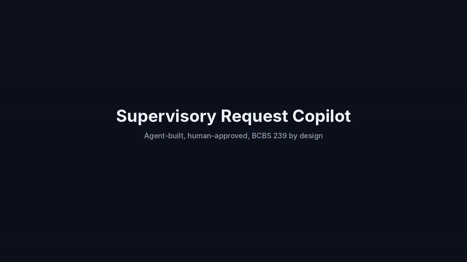
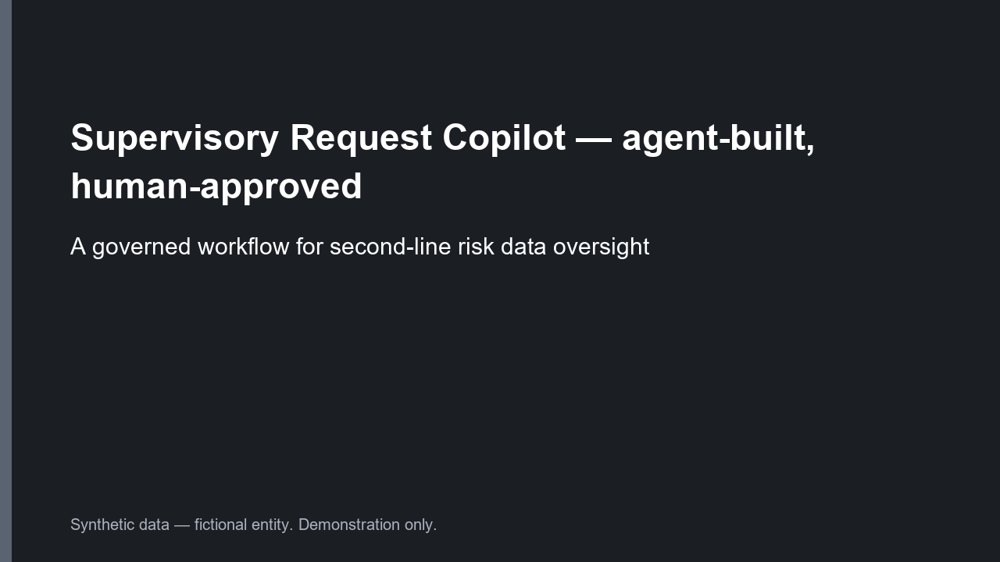
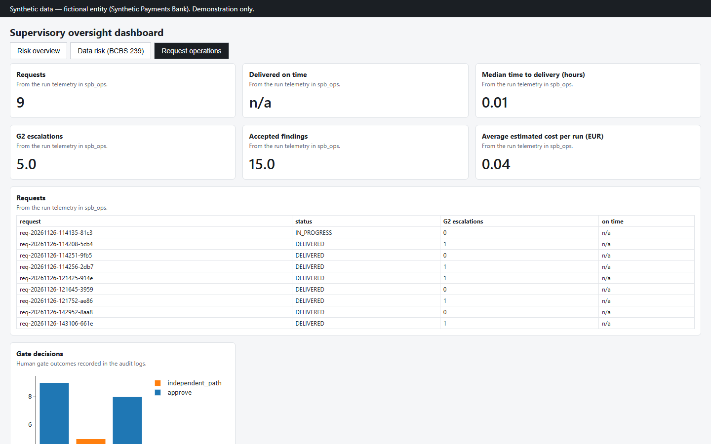

# Supervisory Request Copilot

**An agentic workflow for second-line (2LoD) risk data oversight, built so that every number it delivers can be defended to a supervisor.**

It answers supervisory data requests in four steps:
1. It turns an ambiguous request into a confirmed specification.
2. It compiles governed SQL against a BigQuery warehouse.
3. It validates the result with an independent, code-based checker.
4. It routes every material decision through a human gate.

LLMs sit inside bounded nodes. They draft, clarify and explain. They never pick the next step, never grade their own work and never produce a figure.

> Synthetic data only, for a fictional institution ("Synthetic Payments Bank"). Not affiliated with any real company. Not legal or regulatory advice.



*End-to-end flow. Purple: LLM agents (Claude). Blue: deterministic code. Amber: human gates. Green: data on BigQuery. Teal: publishing.*

**[▶ Interactive walkthrough](https://catalin-badea-aurelian.github.io/supervisory-request-copilot/walkthrough/)**: the same flow with a worked example, step by step, with previous/next controls.

---

## The problem

Second-line oversight teams answer a steady flow of ad-hoc data requests from supervisors, risk committees and internal audit. The pain points are always the same:
- definitions drift between teams;
- figures cannot be reproduced a month later;
- reconciliations are manual;
- nobody can show *who approved what, based on which data*.

Adding a chatbot makes this worse, unless the controls are designed in from the start.

## What the copilot does

| Step | Who | What happens |
|---|---|---|
| Intake | LLM agent + human | Clarifying questions until the request is a typed `RequestSpec` covering metric variant, perimeter, as-of date and grain. **Gate G1:** a human approves the spec. |
| Analysis (maker) | LLM picks the plan; code compiles and runs it | SQL is compiled from versioned glossary templates (template-first, sqlglot-transpiled), with byte caps, snapshot binding and no free SQL. |
| Validation (checker) | Code only | 13 checks run: schema, primary key, completeness, reconciliation, dual-path recompute, definition drift, variance, prior-submission consistency, timeliness, rerun reproducibility. **Gate G2:** a human decides on any FAIL. |
| Review | LLM + retrieval *(designed, see roadmap)* | Principle-level BCBS 239 review with citations validated against the source text. |
| Delivery | Code + human | Evidence pack, hash-chained audit log, run manifest. **Gate G3:** a human signs off. |

The same governed definitions feed three consumers, so they cannot disagree:
- the copilot workflow;
- a **governed MCP server** for AI self-service;
- the **oversight dashboard** (mart views generated from one domain pack; the LookML project generated from the same pack is optional).

Architecture and diagrams: [docs/ARCHITECTURE.md](docs/ARCHITECTURE.md). Requirements and scenarios: [docs/PROJECT_SPEC.md](docs/PROJECT_SPEC.md).

## AI tool stack, and where the controls sit

The design question was not "can an LLM do this?" but "**where does it need a control, and what proves the control works?**"

| Component | Risk | Control | Evidence |
|---|---|---|---|
| Workflow orchestration | An agent wanders, skips a step or loops | Deterministic LangGraph state machine. Routing is decided by code from state; model output is only an input. | `tests/workflow/` |
| LLM narratives and explanations | Hallucinated figures | **Numbers never come from a model.** Placeholders are filled by code, and a shared number guard rejects any number the input did not supply. | `tests/guards/` |
| Agent outputs | Malformed or out-of-policy output | Pydantic schema on every call. Code re-checks metrics, dimensions, periods and perimeter against the glossary. One retry, then escalation to a human gate. | `tests/agents/` |
| Prompts and models | Silent prompt or model drift | Versioned prompt files with a **SHA-256 prompt lock**. Model ids come from config. Record/replay by default; zero API calls in CI; per-run token budget as a hard stop. | `tests/test_prompt_lock.py`, ADR 015 |
| SQL generation | Free SQL, wrong definitions, runaway cost | Template-first compilation from the governed glossary. A parser-enforced SQL policy (no DDL/DML, allowlisted tables). `maximum_bytes_billed`, required partition filters, job labels. | `tests/test_data_policy.py`, golden tests on DuckDB and BigQuery |
| Validation | A model grading its own work | The checker is **code**, separate from the maker, including an independent dual-path recompute. | `tests/validation/`, planted defects D1–D4 |
| Dashboard | A chart that shows a number nobody checked | A dashboard spec generated from the pack (glossary metrics, allowed dimensions and pack thresholds only). Every tile is recomputed from independent sources before review; a mismatch blocks **gate GD**. A model may write captions, never figures. | `tests/dashboard/`, ADR 016 |
| **MCP server** | Self-service turning into uncontrolled data access | **No SQL tool.** Five tools only, all on governed templates through the same guarded layer as the workflow. At most 1,000 rows. No thresholds, tolerances or check sets exposed. Every call is logged. | `tests/test_mcp_server.py` |
| Prompt injection | Instructions hidden in data or documents | Untrusted content is wrapped as data. Policy is enforced by tools, not prompts, so a successful injection still cannot run DDL, skip a check or bypass a gate. | Eval E13 *(roadmap)* |
| Human accountability | Automation without ownership | Gates G1, G2, G3 and GD, each recorded with actor, role and reason. G3 cannot pass with unacknowledged WARNs. | `tests/workflow/` |
| Reproducibility and audit | "We can't reproduce last month's figure" | BigQuery snapshots, stored SQL, canonical result hashes, a hash-chained append-only audit log, `copilot rerun`. | `tests/test_audit.py`, `tests/test_hashing.py` |
| Cloud identity | Leaked keys | Keyless: ADC with service-account impersonation; no JSON keys anywhere. A narrow custom role for snapshots (ADR 014). | `docs/GCP_SETUP.md` |

### Why the MCP server has no SQL tool

A "run any SQL" tool would turn every AI assistant into an ungoverned analyst. The MCP server exposes these tools:
- `list_metrics`
- `get_metric_definition`
- `search_catalog`
- `describe_table`
- `run_metric`

Each one resolves to an approved, versioned template and runs through the same guarded data layer, with the same byte caps and logging, as the workflow. Self-service gets **the same number** the second line would deliver, or no number at all.

<!-- screenshot: docs/img/mcp_claude_desktop.png — Claude Desktop answering "chargeback rate, Italy, June 2025" via the governed MCP server -->

## BCBS 239 by design

| Principle | Mechanism in the copilot |
|---|---|
| P1 Governance | Versioned glossary with owners and changelog. Human approval for new definitions. Every gate decision recorded with role. |
| P2 Data architecture | One domain pack as the single source of definitions, used by the workflow, the MCP server, the marts, the dashboard and LookML. Lineage per run. |
| P3 Accuracy and integrity | Reconciliation, dual-path recompute, primary-key and schema checks, canonical hashes, rerun. |
| P4 Completeness | Completeness checks, including unallocated `XX` country lines. Gaps go into a limitations section. |
| P5 Timeliness | Load-timeliness check. As-of date in every spec. Run timing in the manifest. |
| P6 Adaptability | Clarification loop. Template compilation over any allowed dimension. Metric-proposal flow. |
| P7 Reporting accuracy | Validation report attached to every delivery. Variance and prior-submission checks. |
| P8 Comprehensiveness | Explicit perimeter in the spec, with a coverage check. |
| P9 Clarity | Definitions, limitations and a how-to-verify checklist in every pack. |
| P11 Distribution | Nothing is delivered before G3. Approvals and recipients are logged. |

Full mapping: [ARCHITECTURE §20](docs/ARCHITECTURE.md#20-controls--bcbs-239-mapping).

## Oversight dashboard: built by the agent, approved by a human

**Live dashboard: <https://catalin-badea-aurelian.github.io/supervisory-request-copilot/>** (one static HTML file, figures baked in, synthetic data).

The dashboard is not drawn by hand in a BI tool. It is produced by the same kind of controlled flow as a request ([ADR 016](docs/adr/016-presentation-layer.md)):

```
copilot dq scan --as-of 2025-10-15      # data-quality scan -> spb_ops
copilot ops export                      # run telemetry and check results -> spb_ops
make views                              # mart views generated from the domain pack -> spb_marts
copilot dashboard build --scan          # build -> reconcile
copilot gate GD <dashboard-id> --approve --reason "..."   # human gate -> publish
```

1. **Build.** A spec (`dashboards/specs/<id>.yaml`) is generated from the domain pack: only glossary metrics, their allowed dimensions and the pack's thresholds. The renderer reads `spb_marts` and writes one self-contained HTML file: Plotly embedded, three tabs, a synthetic-data banner, and a footer with the run id, spec hash and data snapshot hash. The unallocated country (`XX`) is excluded from the country RAG. A model may write titles and captions only (replayed recording, number guard); figures come from code.
2. **Reconcile.** Before anyone looks at it, every tile is recomputed from independent sources: the governed templates through the guarded session, the scan's audit log and the run folders. Any mismatch blocks the gate. The first end-to-end build (on the local test dataset) caught one: the top-10 merchant concentration tile included `XX` on the reference side but not in the mart, so the same tile was computed over two different country sets. It was fixed in the spec (the tile now declares the `XX` exclusion) and the build then reconciled 25 of 25 tiles.
3. **Gate GD.** A human approves or rejects, with a reason, in the hash-chained audit log. Approval is refused if tiles do not reconcile or the page changed after reconciliation.
4. **Publish.** Only an approved dashboard is copied to `docs/dashboard/` (with `evidence.md`: approver, reason, spec hash, data hash, per-tile reconciliation), and a GitHub Pages workflow publishes that folder. CI holds no credentials: the data is already in the approved file.



| Risk overview | Data risk (BCBS 239) | Request operations |
|---|---|---|
|  |  |  |

The synthetic data tells a deliberate story that the dashboard makes visible:

| Event | Type | What the checks and dashboard show |
|---|---|---|
| Italy, June 2025: chargeback rate 1.23% (red threshold 0.90%) | **Genuine risk event** | Red on the risk view, all data checks PASS |
| Spain, August 2025: duplicated group-product rows | Data error | Primary-key, reconciliation and dual-path FAILs on ES only |
| September 2025: partial load, null countries, definition change | Data events | Timeliness, completeness and definition-drift FAILs |

Mart views in BigQuery are generated from the domain pack too: ratios are SUM/SUM, non-additive metrics are restricted to valid grains. A LookML project (model, explores, three dashboards) is generated from the same pack and tested offline, so it is ready for a Looker instance if you have one; nothing here needs it.

## Built with a coding agent, under controls

The repository was built with Claude Code. The coding agent was treated like the copilot's own agents: useful inside a bounded role, never trusted on its own.
- **Contract:** `CLAUDE.md` sets out the non-negotiable principles, hard constraints, build order and definition of done.
- **Process:** plan mode, then human review of the plan, implementation on a branch, CI, and a human merge only on green.
- **Gates in CI:** tests, ruff, mypy, pre-commit, prompt lock, and zero API calls (replay only).
- **Not allowed to the agent:** IAM changes without explicit approval, pushing or merging, secrets, live LLM calls in tests, naming real institutions.
- **Decisions recorded** as ADRs (`docs/adr/`, summary in ARCHITECTURE §19).

## Status

| Milestone | Scope | Status |
|---|---|---|
| M0–M1 | Scaffold, synthetic data generator (1.5M transactions, 8 EEA countries, seeded defects), BigQuery EU environment, keyless IAM | ✅ |
| M2 | Domain pack, SQL compiler, check catalogue, golden tests on DuckDB and BigQuery | ✅ |
| M3 | Guarded data layer, snapshots, governed MCP server | ✅ |
| M4 | LangGraph workflow, agents, gates, LLM gateway (record/replay), number guard, audit log | ✅ |
| M8a | DQ scan, ops export, generated marts and LookML, consistency tests | ✅ |
| M8b | Oversight dashboard as code: generated spec, independent tile reconciliation, gate GD, static publish | ✅ |
| M5 | BCBS 239 reviewer (retrieval with validated citations), full evidence pack | 📐 designed |
| M6 | Human-approved metric proposal flow | 📐 designed |
| M7 | Alerts workflow, eval suite report, one-command demo | 📐 designed |

559 offline tests pass in CI (no network, no API key, zero LLM calls).

## Run it locally

```bash
uv sync
uv run poe data      # generate synthetic data (DuckDB, seed 42)
uv run poe test      # offline test suite, no cloud and no API key needed
```

The dashboard commands above also run locally on DuckDB (`COPILOT_BACKEND=duckdb`).

The BigQuery setup is in [docs/GCP_SETUP.md](docs/GCP_SETUP.md).

## Limitations

- Synthetic data with planted defects. Real data is messier.
- Not a validated model under any model-risk framework. See ARCHITECTURE §22 for the path to production and §23 for known limitations.
- Regulatory texts are fetched at runtime and quoted only briefly, with attribution.

## License

MIT
