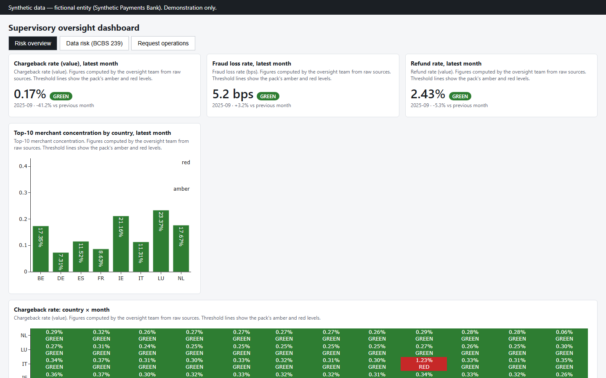
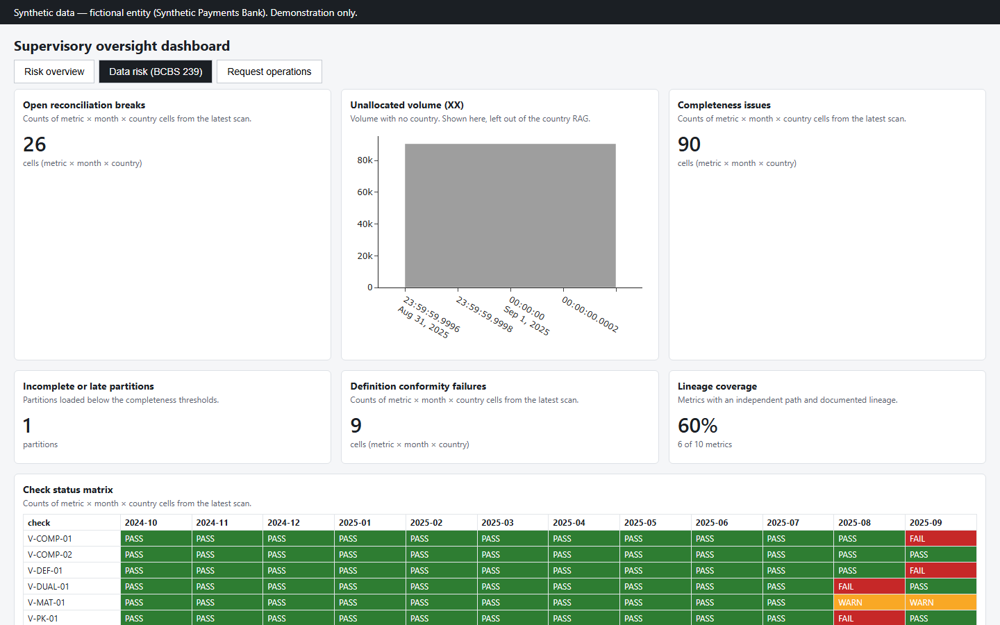

# Supervisory Request Copilot

A governed, agentic workflow for second-line (2LoD) risk data oversight at a
fictional EU payments institution — turning ambiguous supervisory data
requests into evidence packs an institution can stand behind, with
maker-checker validation, BCBS 239 review, human sign-off gates, and a
hash-chained audit trail.

**Status:** early scaffold (M0). See `docs/PROJECT_SPEC.md` and
`docs/ARCHITECTURE.md` for what is being built and why; the build order and
milestones are in `CLAUDE.md`. A full quickstart, scenario walkthroughs,
dashboard screenshots and evaluation results land as the project reaches M7.

## Dashboards

The oversight dashboard is built by the copilot, not by hand (`docs/adr/016-presentation-layer.md`).
Three tabs, all from the governed marts: **Risk overview**, **Data risk (BCBS 239)** and
**Request operations**.

```
copilot dq scan --as-of 2025-10-15          # the data-quality scan
copilot ops export                          # run telemetry to spb_ops
make views                                  # mart views from the domain pack
copilot dashboard build --scan              # spec -> candidate HTML -> every tile reconciled
copilot gate GD <dashboard-id> --approve --reason "figures match the marts"
```

- The spec (`dashboards/specs/<id>.yaml`) is generated from the domain pack: only glossary
  metrics, their allowed dimensions and the pack's thresholds. A language model may write titles
  and captions only (replayed recording, number guard).
- Before review, each tile is recomputed from independent sources. Any mismatch blocks gate GD.
- Only an approved dashboard is copied to `docs/dashboard/` (with `evidence.md`), and a GitHub
  Pages workflow publishes that folder. The page is one HTML file with Plotly embedded.

Live report: _TODO: add the GitHub Pages link after the first approved publish._

| Risk overview | Data risk (BCBS 239) | Request operations |
|---|---|---|
|  |  |  |

_Screenshots: TODO, add them to `docs/img/` from the approved page._

Looker is optional: the LookML project is still generated into `looker/` and unit-tested.

## Disclaimer

This project uses **synthetic data only**, for a **fictional entity**
("Synthetic Payments Bank"). It is not affiliated with, and does not
represent, any real institution. Nothing here is legal, compliance or
regulatory advice. Regulatory source documents (e.g. BCBS 239) are fetched at
runtime and only ever quoted briefly, with attribution.
