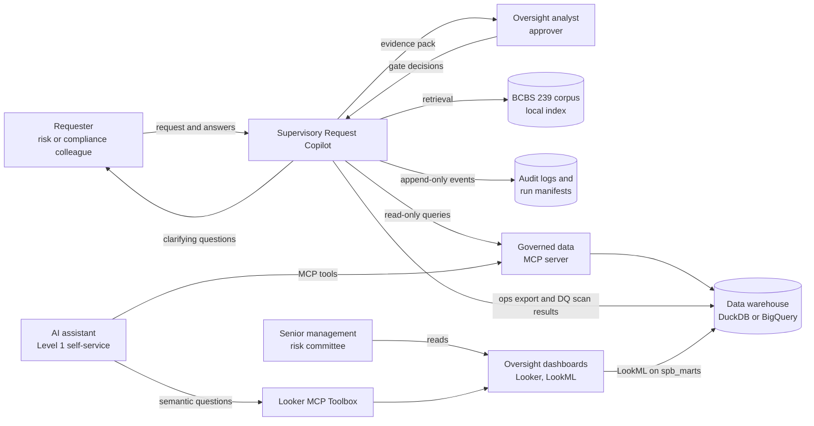
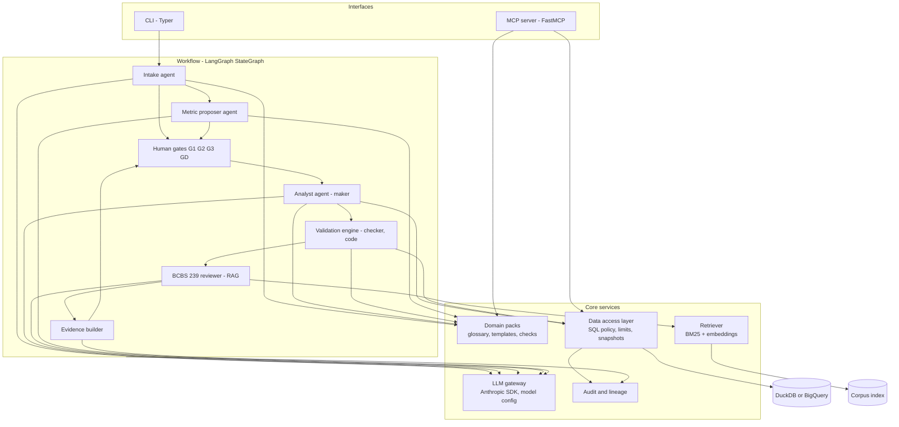
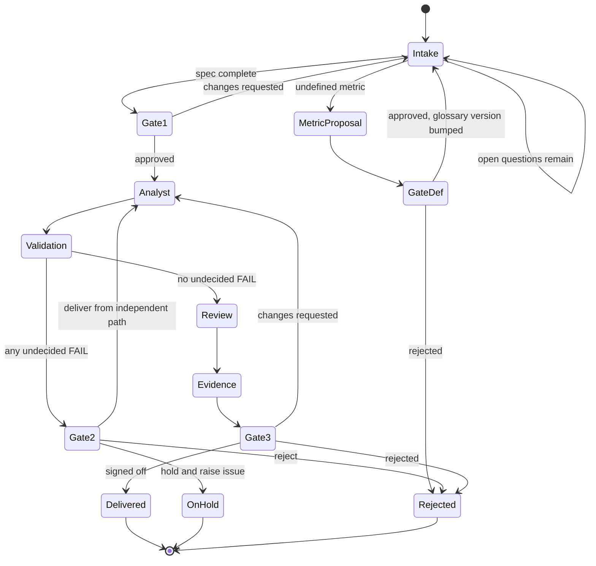
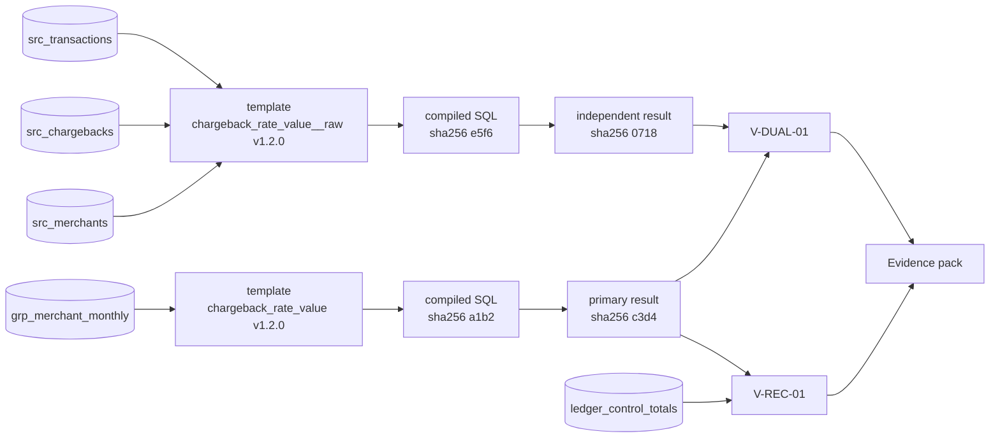
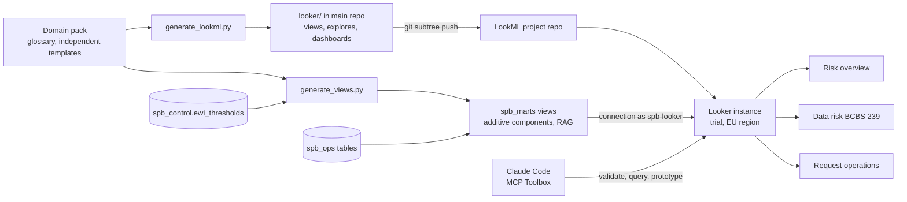

# Supervisory Request Copilot — Technical Architecture

| | |
|---|---|
| Version | 0.1 (draft) |
| Author | Catalin Badea |
| Companion | `docs/PROJECT_SPEC.md` (requirements, scenarios, milestones) |

---

## 1. Purpose and scope

This document describes how the Supervisory Request Copilot is built: components, workflow, agent contracts, data access, validation, retrieval, human gates, audit and rerun, security, and the key design decisions. The fictional institution is **Synthetic Payments Bank (SPB)**; all data is synthetic.

## 2. Architecture principles

| # | Principle | Consequence in the design |
|---|---|---|
| P-1 | **Deterministic orchestration** | The workflow is an explicit LangGraph state machine. LLMs never choose the next step on their own. |
| P-2 | **Maker–checker** | Producing figures (Analyst) and validating them (Validation engine) are separate components; the checker is code. |
| P-3 | **Numbers come from data, never from a model** | Narratives use placeholders filled by code from query results. |
| P-4 | **Governed definitions first** | SQL is compiled from versioned glossary templates; free SQL is exceptional and flagged. |
| P-5 | **Human accountability** | Explicit gates (G1, G2, G3, GD); every decision recorded with actor and role. |
| P-6 | **Reproducibility** | Snapshots, stored SQL, canonical result hashes, hash-chained audit log. |
| P-7 | **Least privilege, enforced in code** | Per-agent tool allowlists; read-only data access; SQL policy enforced by a parser, not by prompts. |
| P-8 | **Configuration over code for domains** | New domains are added as domain packs (YAML + SQL templates). |

## 3. System context and components

### 3.1 Context



### 3.2 Components



| Component | Type | Responsibility |
|---|---|---|
| Intake agent | LLM | Request → confirmed `RequestSpec` via clarifying questions |
| Analyst agent | LLM + compiler | Spec → compiled SQL → primary result |
| Validation engine | Code | Runs the metric's check set; produces `ValidationReport` |
| BCBS 239 reviewer | LLM + RAG | Principle-level review with validated citations; verification checklist |
| Evidence builder | Code (+ LLM narrative with placeholders) | Assembles the evidence pack |
| Metric proposer | LLM | Drafts a new metric definition for GD approval |
| Human gates | Code (LangGraph interrupts) | Pause, present options, record decisions |
| Domain packs | Config | Glossary, templates, sources, checks, tolerances, changelog |
| Data access layer | Code | SQL policy, cost limits, snapshots, dialect transpilation |
| Retriever | Code | Hybrid retrieval over the BCBS 239 corpus |
| LLM gateway | Code | Model selection, retries, schema validation, token and cost accounting |
| Audit and lineage | Code | Hash-chained event log, run manifest, lineage graph |
| MCP server | Code | Governed Level 1 access to metrics (templates only) |

## 4. Workflow

### 4.1 State machine



When the G2 decision is "deliver from independent path", the Analyst re-runs with `source_override=independent`. Validation runs again on the new primary result. The findings already decided at G2 (same check id and same slices) are carried as **accepted findings**: they keep status FAIL, get `accepted_ref` pointing to the G2 decision, appear as documented limitations in the evidence pack, and do not re-trigger G2. Any **new** FAIL goes to G2 again. This prevents escalation loops without hiding anything.

### 4.2 Nodes

| Node | Kind | Input | Output | Notes |
|---|---|---|---|---|
| `intake` | LLM loop | raw request, Q&A history | `RequestSpec` draft, questions | Loops through a human-answer interrupt until complete |
| `metric_proposal` | LLM | unmatched measure, catalog | `MetricProposal` | Only if `undefined_metric` |
| `gate_def` | Human | `MetricProposal` | approve / edit / reject | Writes pack on approval |
| `gate_1` | Human | `RequestSpec` | approve / changes | |
| `analyst` | LLM + compiler | `RequestSpec`, domain pack | `AnalysisResult` | Template-first |
| `validation` | Code | spec, result, snapshot | `ValidationReport` | Deterministic |
| `gate_2` | Human | `ValidationReport` | decision | Only on FAIL |
| `review` | LLM + RAG | spec, result summary, report | `ReviewReport` | Cannot alter numbers |
| `evidence` | Code + LLM | everything above | `EvidencePack` | Placeholders filled by code |
| `gate_3` | Human | `EvidencePack` | decision | WARN acknowledgement required |

### 4.3 Workflow state (sketch)

```python
class RunState(TypedDict):
    request_id: str
    raw_request: str
    qa_history: list[QAPair]
    spec: RequestSpec | None
    proposal: MetricProposal | None
    analysis: AnalysisResult | None
    validation: ValidationReport | None
    review: ReviewReport | None
    evidence: EvidencePack | None
    decisions: list[GateDecision]
    status: Literal["IN_PROGRESS", "ON_HOLD", "REJECTED", "DELIVERED"]
```

## 5. Agents

| Agent | Model tier | Allowed tools | Output contract | Must never |
|---|---|---|---|---|
| Intake | main | `glossary_search`, `get_metric_definition`, `precedent_search` | `RequestSpec` + `questions[]` | Touch data tables; assume as-of date, perimeter or definition variant |
| Analyst | main | `get_metric_definition`, `describe_table`, `compile_metric_query`, `run_query` | `AnalysisResult` | See thresholds or the defect manifest; write data |
| Metric proposer | main | `search_catalog`, `describe_table`, `sample_rows` (≤ 20 rows) | `MetricProposal` | Write to the domain pack (only the GD gate does) |
| Reviewer | main | `retrieve_bcbs239` | `ReviewReport` | Change figures or check statuses; cite unretrieved text |
| Narrative writer | fast | none | Markdown with placeholders | Emit literal numbers (rejected by a regex guard) |
| Failure explainer | fast | none (reads check output only) | short text | Change a check status |

Common rules:

- Temperature 0 for extraction and classification; small positive temperature only for narrative drafting.
- Every output is parsed into its Pydantic model. On failure: one retry with the validation error, then escalate to the next human gate.
- Content from data, documents and tool results is wrapped as **data** in prompts; instructions found inside it are ignored. Policy is enforced by tools, so a successful injection still cannot run DDL, skip a check, or bypass a gate.

## 6. Contracts (Pydantic sketches)

```python
class Period(BaseModel):
    start: date
    end: date
    grain: Literal["month", "quarter"]

class RequestSpec(BaseModel):
    request_id: str
    title: str
    requester: str
    raw_request: str
    metrics: list[str]                 # glossary ids, resolved
    dimensions: list[str]              # must be allowed by every metric
    filters: dict[str, list[str]]      # e.g. {"merchant_country": ["DE", "FR"]}
    period: Period
    as_of_date: date
    output_format: Literal["table", "table+narrative"]
    deadline: date | None
    precedent_refs: list[str]
    assumptions: list[str]
    open_questions: list[str]          # must be empty to pass G1
    undefined_measures: list[str]      # non-empty routes to metric proposal

class QueryRun(BaseModel):
    metric_id: str
    metric_version: str
    template_id: str | None            # None means non-template
    non_template: bool = False
    rationale: str | None = None
    source_path: Literal["preferred", "independent"]
    sql: str
    sql_sha256: str
    params: dict[str, Any]
    snapshot_id: str
    bytes_processed: int | None
    result_sha256: str

class AnalysisResult(BaseModel):
    request_id: str
    runs: list[QueryRun]
    result_table_ref: str              # parquet path in the run folder

class CheckResult(BaseModel):
    check_id: str
    status: Literal["PASS", "WARN", "FAIL"]
    principle_refs: list[int]          # BCBS 239 principle numbers
    measured: dict[str, Any]
    threshold: dict[str, Any]
    affected_slices: list[dict[str, str]]
    explanation: str | None = None     # LLM-written, labelled as such
    accepted_ref: str | None = None    # G2 decision id if this finding was already decided

class ValidationReport(BaseModel):
    request_id: str
    checks: list[CheckResult]
    report_sha256: str

class PrincipleAssessment(BaseModel):
    principle: int
    status: Literal["met", "partially_met", "not_met", "not_assessed"]
    rationale: str
    evidence_refs: list[str]           # check ids, spec fields
    citations: list[str]               # chunk ids, validated after generation

class VerificationStep(BaseModel):
    description: str
    query: str
    expected: str

class ReviewReport(BaseModel):
    assessments: list[PrincipleAssessment]
    checklist: list[VerificationStep]  # 3 to 5 items

class GateDecision(BaseModel):
    gate: Literal["G1", "G2", "G3", "GD"]
    decision: str
    actor: str
    role: str
    comment: str | None
    acknowledged_warnings: list[str] = []
    ts: datetime

class MetricProposal(BaseModel):
    metric_id: str
    name: str
    definition: str
    numerator: str
    denominator: str | None
    attribution: str
    open_choices: list[str]            # raised as questions, never guessed
    sql_template: str
    independent_sql_template: str
    checks: list[str]
    tolerances: dict[str, dict[str, float]]
```

## 7. Data access layer

### 7.1 Backends

One interface, two adapters:

```python
class Backend(Protocol):
    dialect: str
    def snapshot(self, as_of: date) -> str: ...                    # returns snapshot_id
    def dry_run(self, sql: str, params: dict) -> int | None: ...  # estimated bytes
    def query(self, sql: str, params: dict, snapshot_id: str) -> pa.Table: ...
    def describe(self, table: str) -> TableSchema: ...
```

- **BigQuery (showcase, primary).** Environment described in §7.4. Snapshots are BigQuery table snapshots taken at the as-of timestamp; their fully qualified names are stored in the manifest.
- **DuckDB (local mode).** Data is stored as immutable Parquet files generated from the same seed. `snapshot_id` is the SHA-256 of the file manifest (path + content hash). Runs read only the files listed in the snapshot.

### 7.2 SQL policy (enforced by a parser)

Every query goes through `sqlglot` before execution:

1. Parse; reject anything that is not a single `SELECT` / `WITH … SELECT`.
2. Reject DDL, DML, `EXPORT`, scripting, and multiple statements.
3. Allowlist tables: only those declared in the active domain pack and its control tables.
4. Exploratory queries (`sample_rows`) get a forced `LIMIT 20`.
5. BigQuery: dry run first; reject if estimated bytes exceed `COPILOT_MAX_BYTES_BILLED`.
6. Timeout on every query.
7. Templates are written in BigQuery Standard SQL and transpiled to DuckDB with `sqlglot`. Golden tests run both dialects where available.

### 7.3 Canonical result hashing

Results are sorted by all key columns, decimals rounded to a declared precision (default 10 dp), serialised to Arrow IPC, and hashed with SHA-256. The same canonicalisation is used in runs, reruns and tests, in both backends.

### 7.4 BigQuery showcase environment

**Location.** All datasets in the `EU` multi-region (EU data residency, as an EU institution would require). BigQuery does not join across locations, so every dataset must share it.

**Datasets.**

| Dataset | Contents | Written by |
|---|---|---|
| `spb_raw` | `src_*` source tables, `meta_load_log` | loader |
| `spb_group` | `grp_merchant_monthly` (the parent-group data product) | loader |
| `spb_control` | `ledger_control_totals`, `prior_submissions`, `ewi_thresholds` | loader |
| `spb_snapshots` | Per-run table snapshots (with expiration) | copilot |
| `spb_ops` | `ops_runs`, `ops_check_results`, `ops_gate_decisions`, `ops_metric_catalog` | copilot |
| `spb_marts` | Dashboard views generated from the domain pack | deployed by `make views` (owner) |

**Physical design.**
- `src_transactions` is partitioned by `DATE(txn_ts)`, clustered by `merchant_country, merchant_id`, with `require_partition_filter = TRUE`. Every template must filter on the period, which is also how a real warehouse protects itself.
- `src_chargebacks` is partitioned by `DATE(cb_ts)` and clustered by `txn_id`.
- Small tables (merchants, group product, control tables) are not partitioned.

**Identities (least privilege, no keys).**

| Identity | Project roles | Dataset access |
|---|---|---|
| `spb-loader` service account | BigQuery Job User | WRITER on `spb_raw`, `spb_group`, `spb_control` |
| `spb-copilot` service account | BigQuery Job User | READER on `spb_raw`, `spb_group`, `spb_control`, `spb_marts`; WRITER on `spb_snapshots`, `spb_ops` |
| `spb-looker` service account (Looker → BigQuery connection) | BigQuery Job User | READER on `spb_marts`, `spb_ops` only |
| Human developer | Owner of the demo project | Impersonates the service accounts (Service Account Token Creator on each) |

The code runs with Application Default Credentials obtained through impersonation (`docs/GCP_SETUP.md`). No JSON keys exist.

**Cost and usage controls.**
- `maximum_bytes_billed` on every job (from `COPILOT_MAX_BYTES_BILLED`); dry run before execution.
- Job labels on every job: `request_id`, `component` (`analyst`, `validation`, `scan`, `export`), lowercase per BigQuery label rules. They allow cost attribution per request in `INFORMATION_SCHEMA.JOBS`.
- Batch load jobs for ops export (no streaming inserts).
- A billing budget with alerts on the project (see setup guide). Budgets alert; they do not cap spend.

**Two different "as-of" notions.**
- The **business as-of date** (e.g. 2025-10-15) belongs to the synthetic world. It is applied through data: every source row carries `_loaded_at`, and `meta_load_log` records what was loaded by when. Templates filter `_loaded_at <= @as_of`, which is how D3 (incomplete load) becomes visible.
- The **system snapshot** freezes the physical state of the tables when the run starts, so later reloads cannot change a past run. BigQuery time travel works on wall-clock time only, so it cannot represent the synthetic as-of date.

**Snapshots.** At the start of the analysis step, the copilot snapshots the tables the run will read:

```sql
CREATE SNAPSHOT TABLE `PROJECT.spb_snapshots.src_transactions__req_2025_0042`
CLONE `PROJECT.spb_raw.src_transactions`
OPTIONS (expiration_timestamp = TIMESTAMP_ADD(CURRENT_TIMESTAMP(), INTERVAL 90 DAY));
```

Queries in the run are rewritten to point at the snapshots. Snapshot names go into the manifest, so a rerun within the retention window reads exactly the same data. (Verify the exact DDL against current BigQuery documentation when implementing.)

## 8. Domain packs

### 8.1 Layout

```
domain_packs/payments/
├── pack.yaml                 # id, version, sources, control tables, owners, default tolerances
├── metrics/
│   ├── chargeback_rate_value.yaml
│   └── ...
├── templates/
│   ├── chargeback_rate_value.sql.j2          # preferred source
│   ├── chargeback_rate_value__raw.sql.j2     # independent path
│   └── ...
└── CHANGELOG.md
```

### 8.2 Metric definition (example)

```yaml
id: chargeback_rate_value
version: 1.2.0
status: approved
name: Chargeback rate (value)
owner: "Payments Risk Oversight (fictional role)"
definition: >
  Value of chargebacks raised on settled transactions divided by the value of
  settled transactions, attributed to the month of the original transaction.
unit: ratio
numerator: chargeback_amount_eur
denominator: settled_volume_eur
attribution: transaction_month
allowed_dimensions: [period, merchant_country, mcc_group, payment_method]
preferred_source: grp_merchant_monthly
independent_sources: [src_transactions, src_chargebacks, src_merchants]
sql_template: templates/chargeback_rate_value.sql.j2
independent_sql_template: templates/chargeback_rate_value__raw.sql.j2
reconciles_to:
  table: ledger_control_totals
  measures: [settled_volume_eur, chargeback_amount_eur]
precomputed_columns:
  - {table: grp_merchant_monthly, column: cb_rate}
checks: [V-SCH-01, V-PK-01, V-COMP-01, V-COMP-02, V-REC-01, V-DUAL-01,
         V-DEF-01, V-VAR-01, V-PRIOR-01, V-TIME-01, V-RERUN-01, V-SQL-01]
tolerances:
  V-REC-01: {relative: 0.005}
  V-DUAL-01: {relative: 0.001}
  V-VAR-01: {relative: 0.25}
  V-COMP-01: {warn: 0.001, fail: 0.01}
bcbs239_principles: [3, 4, 5, 6, 7, 9]
changelog:
  - {version: 1.2.0, date: 2025-06-30, change: "Attribution fixed to transaction month", approved_by: approver-01}
```

### 8.3 Template (example)

```sql
-- chargeback_rate_value.sql.j2  (BigQuery Standard SQL; transpiled for DuckDB)
SELECT
  {{ dims | join(', ') }},
  SUM(cb_amount_eur)                                AS chargeback_amount_eur,
  SUM(settled_volume_eur)                           AS settled_volume_eur,
  SAFE_DIVIDE(SUM(cb_amount_eur), SUM(settled_volume_eur)) AS chargeback_rate_value
FROM {{ source('grp_merchant_monthly') }}
WHERE month BETWEEN @period_start AND @period_end
  
  AND merchant_country IN ({{ filters.merchant_country | sql_literals }})
  
GROUP BY {{ dims | join(', ') }}
```

Filter values are validated against the allowed values in the pack before rendering; dimensions come only from `allowed_dimensions`.

### 8.4 Versioning

- Pack and metrics use semantic versions. Any change goes through GD (new metric) or a reviewed commit (edits).
- The run manifest records the pack version and its content hash; reruns fail fast if that exact version is not available.

## 9. Validation engine

### 9.1 Check catalogue

| ID | Check | What it does | BCBS 239 | Default severity |
|---|---|---|---|---|
| V-SCH-01 | Schema and grain | Result columns, types and grain match the spec; no unexpected fan-out | P3 | FAIL |
| V-PK-01 | Key uniqueness | Primary keys unique in every source table used | P3 | FAIL |
| V-COMP-01 | Dimension completeness | Null or unknown rate of requested dimensions within thresholds | P4 | WARN / FAIL |
| V-COMP-02 | Perimeter coverage | Every in-scope country × period × category present, or explicitly zero | P4, P8 | FAIL |
| V-REC-01 | Reconciliation to ledger | Totals per period × country vs `ledger_control_totals` within tolerance | P3, P7 | FAIL |
| V-DUAL-01 | Independent recomputation | Recompute through the independent path and compare with the primary result | P3, P7 | FAIL |
| V-DEF-01 | Definition conformity | Pre-computed metric columns from data products equal the glossary recomputation | P1, P3 | FAIL |
| V-VAR-01 | Variance vs prior period | Period-over-period changes beyond threshold flagged for explanation | P7 | WARN |
| V-PRIOR-01 | Consistency with prior submissions | Overlapping periods match previously submitted figures, or differences are explained | P7, P9 | WARN |
| V-TIME-01 | Data freshness | `meta_load_log` shows sources complete up to the as-of date | P5 | WARN / FAIL |
| V-RERUN-01 | Determinism | Re-executing on the same snapshot gives an identical result hash | P3 | FAIL |
| V-SQL-01 | Query policy | Template used; any non-template query flagged | P1, P2 | WARN |

### 9.2 Runner

```python
def run_checks(spec, analysis, pack, backend) -> ValidationReport:
    results = []
    for metric_id in spec.metrics:
        metric = pack.metrics[metric_id]
        for check_id in metric.checks:
            check = REGISTRY[check_id]
            results.append(check(spec, analysis, metric, backend,
                                 thresholds=metric.tolerances.get(check_id, pack.defaults[check_id])))
    return ValidationReport.build(spec.request_id, results)  # computes report_sha256
```

Each check is a pure function over (spec, results, metric, read-only backend). It returns measured values and affected slices, so a human can see *where* and *by how much* something failed, not just that it failed.

### 9.3 Level 2: data-quality scan

`copilot dq scan --as-of <date>` reuses the same registry without a request:

1. Build a synthetic `RequestSpec` per metric covering the full data range, grain = month, dimension = merchant_country.
2. Compile and run both the preferred and the independent templates (snapshotted as in §7.4).
3. Run each metric's check set; write every `CheckResult` to `spb_ops.ops_check_results` with `run_type='scan'`, the as-of date and the domain pack version.

No LLM is involved. The scan is the Level 2 counterpart of a Level 3 request: the same definitions and checks, run on a schedule. Scheduling (cron, or CI with workload identity federation) is documented as a next step and not needed for the demo.

## 10. RAG for BCBS 239

### 10.1 Corpus

| Source | Use | Handling |
|---|---|---|
| BCBS, *Principles for effective risk data aggregation and risk reporting* (2013) — `https://www.bis.org/publ/bcbs239.pdf` (verify the URL at build time) | Primary corpus | Downloaded at runtime into `corpus/` (gitignored); never committed |
| Optional: supervisory guides on risk data aggregation and reporting | Secondary corpus | Same handling; URLs in `corpus/sources.yaml` |

### 10.2 Ingestion

1. Extract text page by page (`pypdf`). Inspect the document structure first, then write the chunker for it.
2. Chunk on structure, not fixed size: one chunk per numbered paragraph, grouped under its principle heading. Keep principle title and number on every chunk.
3. Chunk metadata: `chunk_id`, `doc_id`, `principle_no`, `principle_title`, `paragraph_no`, `page`.
4. Build two indexes: BM25 over tokens, and dense embeddings (`COPILOT_EMBEDDING_MODEL`). The corpus is small, so a flat in-memory index persisted to disk is sufficient.

### 10.3 Retrieval and grounding

- For each applicable principle, build a query from the principle name, the metric definition, and the relevant check outcomes.
- Hybrid ranking with reciprocal rank fusion; top-k = 6; filter by `principle_no` when the principle is known.
- The reviewer receives only retrieved chunks, each with its `chunk_id`.
- **Post-generation citation validation:** every cited `chunk_id` must be in the retrieved set for that principle; quoted text must be a substring of the chunk and at most 25 words. Any violation triggers one regeneration, then the principle is marked `not_assessed`.

### 10.4 Applicability

Principles 1–11 apply to the institution. For a single deliverable the reviewer focuses on 3–9 (aggregation and reporting) and notes 1–2 (governance, architecture) through the definition and lineage evidence. Principles 12–14 address supervisors and are out of scope.

## 11. Human-in-the-loop gates

- Gate nodes call LangGraph `interrupt()` with a payload: gate id, summary, options, and required acknowledgements.
- The CLI renders the payload and collects a `GateDecision`; the graph resumes with `Command(resume=decision)`.
- State is persisted by a SQLite checkpointer (`runs/checkpoints.sqlite`), so a run can wait at G3 overnight and resume with `copilot resume <id>`.
- `make demo` supplies scripted decisions from `demo/answers/*.yaml`; the audit log marks them `actor=scripted-demo`.
- G3 cannot be approved while unacknowledged WARNs exist; the CLI requires each WARN id to be acknowledged explicitly.

| Gate | Trigger | Options | Effect |
|---|---|---|---|
| G1 | Spec complete | approve / request changes | Proceed to Analyst, or back to Intake |
| G2 | Any FAIL not yet decided | independent path with limitation / hold and raise issue / reject | Re-run, `ON_HOLD` with issue note, or `REJECTED` |
| G3 | Evidence pack ready | approve / request changes / reject | `DELIVERED`, back to Analyst, or `REJECTED` |
| GD | Undefined metric | approve / edit / reject | Pack version bump and resume, or `REJECTED` |

## 12. Audit, lineage, rerun and evidence

### 12.1 Audit log

`runs/<request_id>/audit.jsonl`, append-only, one event per line:

```json
{
  "seq": 17,
  "ts": "2025-10-03T09:14:22Z",
  "request_id": "REQ-2025-0042",
  "event_type": "query_executed",
  "actor": "analyst-agent",
  "role": "maker",
  "model_id": null,
  "prompt_id": null,
  "payload_ref": "queries/q03.json",
  "payload_sha256": "…",
  "prev_event_sha256": "…",
  "event_sha256": "…"
}
```

- `event_sha256 = sha256(prev_event_sha256 + canonical_json(event_without_hash))`; the first event uses a fixed genesis value.
- Event types: `request_received`, `question_asked`, `answer_received`, `spec_drafted`, `gate_decision`, `llm_call`, `tool_call`, `query_executed`, `check_result`, `retrieval`, `citation_validated`, `evidence_built`, `pack_updated`, `status_changed`.
- `copilot audit verify <id>` recomputes the chain and reports the first broken link, if any.

### 12.2 Run manifest

`runs/<request_id>/manifest.json` holds everything needed to reproduce the numbers: spec hash, domain pack id, version and content hash, snapshot id, every `QueryRun` (SQL, params, hashes), validation report hash, review and evidence hashes, and gate decisions.

### 12.3 Rerun

1. Load the manifest and verify the audit chain.
2. Resolve the exact domain pack version and the snapshot; fail fast if either is unavailable.
3. Re-execute every stored SQL statement against the snapshot; canonicalise and hash the results.
4. Re-run validation; compare the report hash.
5. Print a diff table: expected vs actual hashes per query and per check.

LLM steps are **not** re-executed: their recorded outputs are part of the record. Rerun proves the numbers, not the prose.

### 12.4 Evidence pack sections

1. Cover: request id, title, requester, approver, status, as-of date, pack version, run time
2. Answer: result table (and an optional chart)
3. Narrative: LLM-drafted, numbers injected by code
4. Confirmed request specification, with the clarification Q&A
5. Definitions used, with metric versions
6. Data lineage: sources, snapshot id, SQL hashes (full SQL in the appendix)
7. Validation results: every check, with status, measured values, thresholds, affected slices
8. BCBS 239 review: per-principle assessment with citations
9. How to verify: 3–5 steps with runnable queries
10. Limitations and assumptions, including any G2 decision
11. Approvals: all gate decisions
12. Appendix: SQL, audit log excerpt, rerun command

### 12.5 Lineage (example for S2)



### 12.6 Ops export to BigQuery

After every run, and on `copilot ops export`, the copilot batch-loads operational facts into `spb_ops`:

| Table | Grain | Key columns |
|---|---|---|
| `ops_runs` | one row per run | request_id, title, received_at, deadline, delivered_at, status, pack_version, llm_calls, tokens_in, tokens_out, est_cost_eur, bytes_processed, duration_s |
| `ops_check_results` | one row per check × slice | run_id, run_type (`request` / `scan`), as_of, metric_id, metric_version, check_id, principle_refs, status, measured, threshold, period_month, merchant_country, accepted_ref |
| `ops_gate_decisions` | one row per decision | request_id, gate, decision, actor, role, ts, acknowledged_warnings |
| `ops_metric_catalog` | one row per metric version | metric_id, version, owner, status, has_independent_path, lineage_documented, reconciles_to, changed_at |

The audit log in the run folder remains the record of truth; `spb_ops` is a reporting copy for the dashboard.

## 13. Security and guardrails

### 13.1 Tool allowlist per agent

| Agent | Tools | Data access | Writes |
|---|---|---|---|
| Intake | `glossary_search`, `get_metric_definition`, `precedent_search` | Metadata only | None |
| Analyst | `get_metric_definition`, `describe_table`, `compile_metric_query`, `run_query` | Read-only, allowlisted tables, snapshot-bound | Run folder (results) |
| Metric proposer | `search_catalog`, `describe_table`, `sample_rows` | Read-only, max 20 rows | None |
| Reviewer | `retrieve_bcbs239` | Corpus only | None |
| Narrative writer | none | Placeholders only | None |
| Validation engine (code) | backend read API | Read-only | Run folder (report) |
| GD gate handler (code) | pack writer | — | Domain pack (on approval only) |
| Ops exporter / DQ scan (code) | backend read API, batch load | Read-only on source datasets | `spb_ops`, `spb_snapshots` only |
| Looker (connection as `spb-looker`) | — | Views in `spb_marts` and tables in `spb_ops` | None |
| Claude Code via Looker MCP Toolbox (build time) | Looker API as the developer user | LookML project (dev mode), queries | Personal-folder prototypes only; LookML changes go through Git |

### 13.2 Other controls

- **Secrets:** environment variables only; `.env` gitignored; the BigQuery service account has read-only roles on the demo dataset.
- **Prompt injection:** untrusted content is delimited as data; tools enforce policy independently of the prompt; eval case E13 tests it.
- **Data minimisation:** agents receive schemas, aggregates and small samples, never full tables.
- **Cost controls:** byte limits, query timeouts, per-run token budget with a hard stop that escalates to a human.
- **Isolation of test assets:** the defect manifest lives under `tests/`, outside every agent's tools and outside the package.

## 14. Model and prompt governance

- Model ids come from configuration (`COPILOT_MODEL_MAIN`, `COPILOT_MODEL_FAST`); agents never hard-code them.
- Prompts are versioned files with front-matter (`id`, `version`, `owner`, `change`). Prompt id and version are logged on every call.
- Any change to a prompt, model id or domain pack must pass `make eval` before merge (manual gate in the PR template).
- The eval report records model ids and prompt versions, so results are attributable.
- In a real institution this inventory (agents, prompts, models, evals) would be registered as a model and validated independently; see §22.

## 15. Observability and cost

- A per-run summary at the end of the CLI output and in the manifest: duration per node, LLM calls, tokens in/out, estimated cost, bytes processed, checks by status.
- The eval report aggregates cost and latency across cases.
- Structured logs (JSON) for debugging, separate from the audit log.

## 16. Error handling and escalation

| Situation | Handling |
|---|---|
| LLM output fails schema validation | One retry with the error; then escalate to the next gate with the raw output attached |
| Query rejected by SQL policy | Returned to the Analyst with the reason; after 2 rejections escalate |
| Byte limit exceeded | Rejected before execution; Analyst must narrow; then escalate |
| Any check FAIL | G2 |
| Retrieval empty or citations invalid after retry | Principle marked `not_assessed`; visible in the evidence pack |
| Token budget exceeded | Stop and escalate with partial state checkpointed |
| API or network outage | State checkpointed; `copilot resume <id>` continues |
| Snapshot or pack version missing on rerun | Fail fast with a clear message |

## 17. Repository structure

```
supervisory-request-copilot/
├── CLAUDE.md
├── README.md
├── LICENSE
├── Makefile
├── pyproject.toml
├── .env.example
├── .github/workflows/ci.yml
├── docs/
│   ├── PROJECT_SPEC.md
│   ├── ARCHITECTURE.md
│   ├── GCP_SETUP.md
│   ├── DASHBOARD_SPEC.md
│   ├── DEMO_SCRIPT.md
│   └── adr/
├── infra/
│   └── bigquery/               # dataset creation, access entries, table DDL (partitioning, clustering)
├── dashboards/
│   ├── views/                  # generated mart view SQL (committed, reviewed in PRs)
│   ├── generate_views.py       # domain pack -> mart view SQL
│   └── screenshots/
├── looker/                     # LookML project, published to its own repo via git subtree
│   ├── manifest.lkml
│   ├── spb_oversight.model.lkml
│   ├── views/                  # generated *.view.lkml
│   ├── refinements/            # hand-written refinements (+view), never overwritten
│   ├── dashboards/             # *.dashboard.lookml (generated + refined)
│   └── generate_lookml.py      # domain pack -> LookML
├── domain_packs/payments/...
├── data/
│   └── generator/              # seeded generator, defect injectors
├── corpus/                     # gitignored; filled by scripts/fetch_corpus.py
├── scripts/fetch_corpus.py
├── src/copilot/
│   ├── config.py
│   ├── cli.py
│   ├── contracts/              # Pydantic models
│   ├── llm/                    # gateway
│   ├── prompts/                # versioned prompt files
│   ├── agents/                 # intake, analyst, proposer, reviewer, narrative
│   ├── data/                   # backends, sql policy, snapshots, hashing
│   ├── packs/                  # domain pack loader, compiler, writer
│   ├── validation/
│   │   ├── checks/
│   │   └── runner.py
│   ├── rag/                    # ingest, index, retrieve, citation validation
│   ├── evidence/               # builder, templates (Jinja2)
│   ├── audit/                  # event log, manifest, rerun, verify
│   ├── workflow/               # LangGraph graph, state, gates
│   └── mcp_server/
├── demo/answers/               # scripted gate decisions for make demo
├── evals/
│   ├── cases/
│   ├── run_evals.py
│   └── REPORT.md
├── examples/                   # committed sample evidence packs and audit logs
└── tests/
    ├── fixtures/               # incl. defects_expected.yaml (test-only)
    └── ...
```

## 18. Technology choices

| Concern | Choice | Why |
|---|---|---|
| Orchestration | LangGraph | Explicit graph, native human interrupts, persistent checkpoints: fits deterministic control flow and pause/resume |
| LLM | Anthropic SDK behind a gateway | Strong tool use and structured output; the gateway isolates model choice |
| Contracts | Pydantic v2 | Typed, validated boundaries for every LLM output |
| Warehouse | BigQuery (showcase, EU) + DuckDB (local mode) | BigQuery is the realistic enterprise target; DuckDB keeps the repo runnable for anyone |
| Semantic layer + dashboards | Looker (Google Cloud core trial), LookML generated from the domain pack, LookML dashboards | Enterprise-grade semantic layer on BigQuery; dashboards as code; AI access through MCP on governed measures |
| BI automation | MCP Toolbox for Databases (Looker) | Lets Claude Code validate the project, run queries and prototype dashboards |
| BI fallback | Looker Studio on the same marts (optional) | Free public view-only link after the trial ends |
| SQL policy | sqlglot | Real parsing for policy enforcement and dialect transpilation |
| MCP | Python MCP SDK (FastMCP) | Standard protocol; the same governed layer serves AI assistants (Level 1) and the workflow |
| Retrieval | BM25 + small local embeddings | Small corpus; no external vector service; offline and free |
| Evidence | Jinja2 → Markdown/HTML | Human-readable, diffable, easy to attach |
| CLI | Typer + Rich | Clear gate prompts in the terminal |

## 19. Architecture decision records (summary)

Full ADRs live in `docs/adr/`. Summary:

| ADR | Decision | Rationale | Consequence |
|---|---|---|---|
| 001 | Deterministic workflow graph; LLMs inside bounded nodes | Auditability; predictable behaviour under supervision | Less "autonomy", much easier to explain and test |
| 002 | Validation engine is code, not an LLM | A model should not grade its own work; checks must be reproducible | More upfront work on checks; LLM only explains |
| 003 | Numbers injected by code into LLM narratives | Eliminates hallucinated figures | Narrative templates need placeholders; regex guard rejects literal numbers |
| 004 | Template-first SQL from a governed glossary | Definition consistency; reviewable logic | Coverage limited to defined metrics; that is intended |
| 005 | Undefined metrics go through a human-approved proposal | Definitions are governance decisions | Slower first answer; fast every time after |
| 006 | Synthetic data with seeded, planted defects | Demonstrates detection controllably and reproducibly | Must document that real data is messier |
| 007 | BigQuery showcase (EU) plus DuckDB local mode | Realistic enterprise environment and a zero-setup path for anyone else | Dialect differences handled by transpilation and golden tests in both backends |
| 008 | Regulatory documents fetched at runtime, quoted briefly | Respect third-party rights | First run needs network access |
| 009 | MCP as the governed data access layer | One governed layer for self-service and workflow | MCP server must enforce the same policy as the workflow |
| 010 | Rerun proves numbers, not prose | LLM text is non-deterministic; numbers must not be | Recorded LLM outputs are part of the evidence |
| 011 | Mart views **and** the LookML semantic layer generated from the domain pack; dashboards as LookML | The dashboards, the copilot and AI self-service must not disagree on a definition | Generated files are never edited; manual changes live in refinement files |
| 012 | Keyless authentication via service-account impersonation | No long-lived secrets to leak; mirrors enterprise practice | Developer needs Token Creator on each service account |
| 013 | Looker as a time-boxed trial; Git is the permanent record | Realistic BI and semantic layer at no cost | Live demo only within 30 days; rebuild steps must be tested; instance deleted before conversion to paid |

## 20. Controls → BCBS 239 mapping

| Principle | What it asks for (paraphrased) | How the copilot evidences it |
|---|---|---|
| P1 Governance | Risk data aggregation under strong governance, with documented policies and ownership | Versioned glossary with owners and changelog; GD approval for new definitions; V-DEF-01; gate decisions with roles |
| P2 Data architecture and IT infrastructure | Architecture that supports aggregation, with consistent definitions and data ownership | Domain packs as single definition source; lineage per run; V-SQL-01 |
| P3 Accuracy and integrity | Accurate, reliable data, largely automated, reconciled | V-REC-01, V-DUAL-01, V-PK-01, V-SCH-01, V-RERUN-01; canonical hashes |
| P4 Completeness | All material risk data captured, with gaps identified | V-COMP-01, V-COMP-02; limitations section |
| P5 Timeliness | Data available in time, including under stress | V-TIME-01; as-of date in every spec; run timing in the manifest |
| P6 Adaptability | Ad-hoc requests answered quickly, including new dimensions | Clarification loop; template compilation over any allowed dimensions; metric proposal flow |
| P7 Accuracy (reporting) | Reports accurate and reconciled, with validation | Validation report in every pack; V-VAR-01, V-PRIOR-01 |
| P8 Comprehensiveness | Reports cover all material risk areas | Perimeter coverage check; explicit scope in the spec |
| P9 Clarity and usefulness | Clear, concise, with interpretation and limitations | Narrative + definitions + limitations + how-to-verify checklist |
| P10 Frequency | Frequency set by recipients' needs | Out of scope for ad-hoc requests; recurring requests are promoted to Level 2 |
| P11 Distribution | Reports reach the right recipients securely and on time | Delivery only after G3; approvals and recipients logged |
| P12–P14 | Supervisory review and cooperation | Addressed to supervisors; not applicable |

## 21. Oversight dashboard

Full model and dashboard specification: `docs/DASHBOARD_SPEC.md`.

### 21.1 Layers



| Layer | What it holds | Generated from |
|---|---|---|
| Mart views (`spb_marts`) | **Additive components** per month × country × MCC (sums and counts), RAG at month × country, ops facts | Domain pack independent templates + thresholds |
| LookML views | Dimensions, **ratio measures** built from summed components, descriptions and tags with metric id and version | Domain pack glossary |
| LookML explores | `ewi`, `ewi_components`, `dq_status`, `timeliness`, `metric_catalog`, `requests`, `gate_decisions` | Fixed template |
| LookML dashboards | Risk overview, Data risk (BCBS 239), Request operations | Generator + refinement files |

### 21.2 Why ratios are measures, not columns

A rate such as `chargeback_rate_value` must not be averaged across countries or months. Marts therefore expose the numerator and denominator components, and LookML defines the rate as `SUM(numerator) / SUM(denominator)` at whatever grain the user chooses. That is the same formula as the copilot's templates, which is what the consistency test checks.

### 21.3 Build and publish

1. `make views` deploys the marts (as the owner).
2. `make lookml` writes `looker/`; unit tests check that every glossary metric appears as a measure with the right formula, description and tags, and that no generated file was hand-edited (header hash).
3. `make lookml-publish` pushes `looker/` to the LookML project repo with `git subtree push`. If Looker accepts the main repo directly with a project subdirectory, simplify; verify when implementing.
4. In Looker: pull to production after validation. `make lookml-check` runs project validation and the consistency test (FR-D6) through the Looker API or MCP Toolbox.

### 21.4 Role of the MCP Toolbox

- **Build time (Claude Code):** validate the project, inspect explores, run queries for the consistency test, and prototype tiles with the dashboard tools. Prototypes live in a personal folder; once agreed, they are exported as LookML and reproduced by the generator or a refinement file.
- **Run time (Level 1 demo):** an AI assistant asks questions against the governed explores. Answers use the generated measures, so they match the dashboards and the copilot.

### 21.5 Principles carried over

- **Independent figures.** Early-warning indicators come from the raw-source path: the oversight team's own numbers, not the parent group's.
- **Risk event vs data event.** Risk overview shows what moved; Data risk shows whether the data behind it can be trusted.
- **Time-boxed instance.** The trial lasts 30 days; Git, screenshots and a recorded walkthrough are the permanent evidence. A Looker Studio report on the same marts can provide a public link after the trial (optional).

## 22. Path to production (how this would map to an enterprise setting)

- **Data access:** managed MCP servers on the enterprise warehouse, identity-aware and scoped per team, with read-only service identities.
- **Models:** an enterprise LLM gateway with approved models, data-residency controls and logging.
- **Semantic layer:** domain-pack definitions would come from (or be certified against) the enterprise semantic layer.
- **Governance:** agents, prompts and packs registered in the model inventory; independent validation before use for regulatory outputs; periodic re-validation driven by the eval suite.
- **Segregation of duties:** enforced by identity management (builder ≠ approver ≠ validator), not only recorded as roles.
- **Audit storage:** audit logs and manifests in immutable (WORM) storage with retention rules.
- **Workflow integration:** gates connected to the institution's workflow or ticketing tool; evidence packs filed in the document management system.
- **BI:** the generated LookML would be merged into the enterprise semantic layer through the normal LookML review process, so self-service, dashboards and the copilot share one definition.

## 23. Limitations

- Synthetic data is cleaner and smaller than production data.
- The reviewer supports, and does not replace, a human assessment of BCBS 239 compliance.
- Segregation of duties is simulated with roles in a single-user demo.
- LLM behaviour can vary between model versions; evals mitigate but cannot eliminate this.
- Not validated for any real use; built as a demonstration of architecture and controls.
